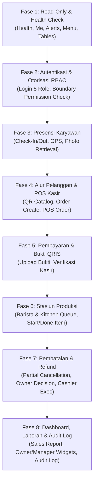

# INVENTARISASI ENDPOINT & MATRIKS PENGUJIAN API (API TESTING MATRIX)
**Task 3.1 — Backend / API Testing Planning Cafe Éxito**\
**Tanggal Audit:** 21 November 2026\
**Framework:** Laravel 13 (PHP 8.3.30)\
**Target Basis Data:** PostgreSQL 16.14 (`cafe_exito`)\
**Total Endpoint Terdaftar:** 79 Endpoint API\
**Status Audit:** Read-Only & Non-Destructive (Zero Mutation)\

---

## A. Ringkasan Eksekutif & Statistik Endpoint

| Parameter | Nilai / Keterangan |
|---|---|
| **Total Endpoint API** | **79 Endpoint** |
| **Endpoint Memerlukan Autentikasi** | **69 Endpoint** (Bearer Token Sanctum) |
| **Endpoint Publik (Tanpa Autentikasi)** | **10 Endpoint** (1 Health, 1 Login, 8 Customer QR) |
| **Endpoint Mengubah Data (State-Changing / Mutation)** | **41 Route** (POST 31, PUT 5, PATCH 3, DELETE 2) |
| **Endpoint Baca Saja (Read-Only / Query)** | **38 Route** (GET; Laravel juga menerima HEAD pada route GET) |
| **Jumlah Modul Fungsional Aktif** | **15 Modul** |
| **Status Modul Inventory & Purchasing** | **RETIRED (Non-aktif / Tidak diekspos di rute API)** |

### Distribusi Endpoint per Modul

| No | Nama Modul | Jumlah Endpoint | Sifat Akses | Prioritas Pengujian |
|---|---|---|---|---|
| 1 | 1. Autentikasi & Profil Pengguna | 5 | Campuran (1 Publik, 4 Auth) | CRITICAL |
| 2 | 2. Katalog & QR Self-Order Pelanggan | 8 | Publik (8) | CRITICAL |
| 3 | 3. Kasir, POS & Verifikasi Pembayaran | 10 | Wajib Login (10) | CRITICAL |
| 4 | 4. Stasiun Produksi (Barista & Kitchen) | 6 | Wajib Login (6) | CRITICAL |
| 5 | 5. Manajemen Pesanan & Transaksi | 5 | Wajib Login (5) | HIGH |
| 6 | 6. Pembatalan Item & Alur Refund | 7 | Wajib Login (7) | CRITICAL |
| 7 | 7. Catatan Konflik Kepentingan Refund | 4 | Wajib Login (4) | MEDIUM |
| 8 | 8. Notifikasi Sistem | 2 | Wajib Login (2) | MEDIUM |
| 9 | 9. Presensi, Shift & Foto GPS Karyawan | 7 | Wajib Login (7) | HIGH |
| 10 | 10. Administrasi Menu & Kategori | 7 | Wajib Login (7) | HIGH |
| 11 | 11. Administrasi Meja & QR Code | 5 | Wajib Login (5) | MEDIUM |
| 12 | 12. Administrasi Pengguna & Reset Password | 5 | Wajib Login (5) | HIGH |
| 13 | 13. Administrasi Izin Khusus Karyawan | 2 | Wajib Login (2) | HIGH |
| 14 | 14. Dashboard Eksekutif, Laporan Penjualan & Audit Log | 4 | Wajib Login (4) | HIGH |
| 15 | 15. Health Check & Staff Alerts | 2 | Campuran (1 Publik, 1 Auth) | MEDIUM |

> **Rekonsiliasi `route:list` (21 November 2026):** terdapat 79 registrasi route dengan signature method+URI yang unik: 38 `GET|HEAD` dan 41 mutasi. `HEAD` adalah metode alias yang dilayani route GET dan tidak dihitung sebagai route tambahan. Registrasi tersebut menggunakan 69 pola URI; beberapa pola memakai metode berbeda, misalnya `/api/v1/auth/me` (GET dan PUT) serta `/api/v1/admin/menus/{menu}` (GET, PUT, DELETE). Tidak ditemukan signature method+URI duplikat. Rincian perbandingan ada di `docs/API_TESTING_RECONCILIATION_REPORT.md`.

---

## B. Inventarisasi Lengkap Endpoint per Modul

### 1. Autentikasi & Profil Pengguna (5 Endpoint)

| No | Method | Endpoint URL | Controller & Action | Auth | Izin / Middleware | Validasi (FormRequest) | Dampak Data | Prioritas |
|---|---|---|---|---|---|---|---|---|
| 1 | `POST` | `/api/v1/auth/login` | `AuthController@login` | Public | `-` | `LoginRequest` | Mutasi Data | CRITICAL |
| 2 | `POST` | `/api/v1/auth/logout` | `AuthController@logout` | Sanctum | `-` | `Request` | Mutasi Data | CRITICAL |
| 3 | `GET` | `/api/v1/auth/me` | `AuthController@me` | Sanctum | `-` | `Request` | Read-Only | HIGH |
| 4 | `PUT` | `/api/v1/auth/me` | `AuthController@update` | Sanctum | `-` | `UpdateProfileRequest` | Mutasi Data | CRITICAL |
| 5 | `POST` | `/api/v1/auth/change-password` | `AuthController@changePassword` | Sanctum | `-` | `ChangePasswordRequest` | Mutasi Data | CRITICAL |

### 2. Katalog & QR Self-Order Pelanggan (8 Endpoint)

| No | Method | Endpoint URL | Controller & Action | Auth | Izin / Middleware | Validasi (FormRequest) | Dampak Data | Prioritas |
|---|---|---|---|---|---|---|---|---|
| 6 | `GET` | `/api/v1/customer/tables/{qrToken}` | `CatalogController@table` | Public | `table.token` | `-` | Read-Only | HIGH |
| 7 | `GET` | `/api/v1/customer/menus` | `CatalogController@menus` | Public | `table.token` | `-` | Read-Only | HIGH |
| 8 | `POST` | `/api/v1/customer/cart/validate` | `CatalogController@validateCart` | Public | `table.token` | `ValidateCartRequest` | Mutasi Data | CRITICAL |
| 9 | `GET` | `/api/v1/customer/payment-info` | `CatalogController@paymentInfo` | Public | `table.token` | `Request` | Read-Only | HIGH |
| 10 | `POST` | `/api/v1/customer/orders` | `CustomerOrderController@store` | Public | `table.token` | `CreateOrderRequest` | Mutasi Data | CRITICAL |
| 11 | `GET` | `/api/v1/customer/orders/{publicToken}` | `CustomerOrderController@show` | Public | `table.token` | `-` | Read-Only | HIGH |
| 12 | `POST` | `/api/v1/customer/orders/{publicToken}/cancel` | `CustomerOrderController@cancel` | Public | `table.token` | `CancelOrderItemRequest` | Mutasi Data | CRITICAL |
| 13 | `POST` | `/api/v1/customer/orders/{publicToken}/payment-proof` | `CustomerOrderController@uploadProof` | Public | `table.token` | `UploadPaymentProofRequest` | Mutasi Data | CRITICAL |

### 3. Kasir, POS & Verifikasi Pembayaran (10 Endpoint)

| No | Method | Endpoint URL | Controller & Action | Auth | Izin / Middleware | Validasi (FormRequest) | Dampak Data | Prioritas |
|---|---|---|---|---|---|---|---|---|
| 14 | `GET` | `/api/v1/cashier/dashboard` | `CashierController@dashboard` | Sanctum | `dashboard.cashier` | `-` | Read-Only | HIGH |
| 15 | `GET` | `/api/v1/cashier/tables` | `CashierController@tables` | Sanctum | `orders.create_pos` | `-` | Read-Only | HIGH |
| 16 | `POST` | `/api/v1/cashier/pos/orders` | `PosOrderController@store` | Sanctum | `orders.create_pos` | `CreatePosOrderRequest` | Mutasi Data | CRITICAL |
| 17 | `POST` | `/api/v1/cashier/orders/{order}/complete` | `CashierController@completeOrder` | Sanctum | `payments.verify` | `Request` | Mutasi Data | CRITICAL |
| 18 | `GET` | `/api/v1/cashier/orders` | `CashierController@orders` | Sanctum | `payments.verify` | `Request` | Read-Only | HIGH |
| 19 | `GET` | `/api/v1/cashier/orders/{order}` | `CashierController@order` | Sanctum | `payments.verify` | `-` | Read-Only | HIGH |
| 20 | `POST` | `/api/v1/cashier/payments/{payment}/verify` | `PaymentController@verify` | Sanctum | `payments.verify` | `VerifyPaymentRequest` | Mutasi Data | CRITICAL |
| 21 | `POST` | `/api/v1/cashier/payments/{payment}/reject` | `PaymentController@reject` | Sanctum | `payments.verify` | `RejectPaymentRequest` | Mutasi Data | CRITICAL |
| 22 | `GET` | `/api/v1/cashier/payments/{payment}/proof` | `PaymentController@proof` | Sanctum | `payments.verify` | `-` | Read-Only | HIGH |
| 23 | `GET` | `/api/v1/cashier/transactions/{order}/receipt` | `CashierController@receipt` | Sanctum | `payments.verify, transactions.view` | `-` | Read-Only | HIGH |

### 4. Stasiun Produksi (Barista & Kitchen) (6 Endpoint)

| No | Method | Endpoint URL | Controller & Action | Auth | Izin / Middleware | Validasi (FormRequest) | Dampak Data | Prioritas |
|---|---|---|---|---|---|---|---|---|
| 24 | `GET` | `/api/v1/station/{station}/dashboard` | `StationController@dashboard` | Sanctum | `station:read` | `Request` | Read-Only | HIGH |
| 25 | `GET` | `/api/v1/station/{station}/tickets` | `StationController@index` | Sanctum | `station:read` | `Request` | Read-Only | HIGH |
| 26 | `GET` | `/api/v1/station/{station}/tickets/{ticket}` | `StationController@show` | Sanctum | `station:read` | `Request` | Read-Only | HIGH |
| 27 | `POST` | `/api/v1/station/{station}/tickets/{ticket}/items/{detail}/start` | `StationController@startItem` | Sanctum | `station:act` | `Request` | Mutasi Data | CRITICAL |
| 28 | `POST` | `/api/v1/station/{station}/tickets/{ticket}/start` | `StationController@start` | Sanctum | `station:act` | `Request` | Mutasi Data | CRITICAL |
| 29 | `POST` | `/api/v1/station/{station}/tickets/{ticket}/complete` | `StationController@complete` | Sanctum | `station:act` | `Request` | Mutasi Data | CRITICAL |

### 5. Manajemen Pesanan & Transaksi (5 Endpoint)

| No | Method | Endpoint URL | Controller & Action | Auth | Izin / Middleware | Validasi (FormRequest) | Dampak Data | Prioritas |
|---|---|---|---|---|---|---|---|---|
| 30 | `GET` | `/api/v1/orders` | `OrderController@index` | Sanctum | `orders.view` | `Request` | Read-Only | HIGH |
| 31 | `GET` | `/api/v1/orders/{order}` | `OrderController@show` | Sanctum | `orders.view` | `-` | Read-Only | HIGH |
| 32 | `POST` | `/api/v1/orders/{order}/cancel` | `OrderController@cancel` | Sanctum | `orders.cancel` | `CancelOrderRequest` | Mutasi Data | CRITICAL |
| 33 | `POST` | `/api/v1/orders/{order}/items/cancel` | `OrderController@cancelItem` | Sanctum | `orders.cancel` | `CancelOrderItemRequest` | Mutasi Data | CRITICAL |
| 34 | `GET` | `/api/v1/transactions` | `TransactionController@index` | Sanctum | `transactions.view` | `Request` | Read-Only | HIGH |

### 6. Pembatalan Item & Alur Refund (7 Endpoint)

| No | Method | Endpoint URL | Controller & Action | Auth | Izin / Middleware | Validasi (FormRequest) | Dampak Data | Prioritas |
|---|---|---|---|---|---|---|---|---|
| 35 | `GET` | `/api/v1/refunds` | `RefundController@index` | Sanctum | `refund.view, refund.review` | `Request` | Read-Only | HIGH |
| 36 | `POST` | `/api/v1/refunds` | `RefundController@createManual` | Sanctum | `refund.request` | `Request` | Mutasi Data | CRITICAL |
| 37 | `POST` | `/api/v1/refunds/{refund}/decision` | `RefundController@decide` | Sanctum | `refund.review` | `Request` | Mutasi Data | CRITICAL |
| 38 | `POST` | `/api/v1/refunds/{refund}/withdraw` | `RefundController@withdraw` | Sanctum | `refund.view` | `Request` | Mutasi Data | CRITICAL |
| 39 | `POST` | `/api/v1/refunds/{refund}/revoke` | `RefundController@revoke` | Sanctum | `refund.review` | `Request` | Mutasi Data | CRITICAL |
| 40 | `POST` | `/api/v1/refunds/{refund}/execute` | `RefundController@execute` | Sanctum | `refund.execute` | `RefundExecuteRequest` | Mutasi Data | CRITICAL |
| 41 | `GET` | `/api/v1/refunds/{refund}/proof` | `RefundController@proof` | Sanctum | `refund.view, refund.review` | `Request` | Read-Only | HIGH |

### 7. Catatan Konflik Kepentingan Refund (4 Endpoint)

| No | Method | Endpoint URL | Controller & Action | Auth | Izin / Middleware | Validasi (FormRequest) | Dampak Data | Prioritas |
|---|---|---|---|---|---|---|---|---|
| 42 | `POST` | `/api/v1/refunds/{refund}/conflict-notes` | `RefundController@conflictNote` | Sanctum | `refund.conflict.document` | `Request` | Mutasi Data | CRITICAL |
| 43 | `GET` | `/api/v1/refunds/{refund}/conflict-notes` | `RefundController@conflictNotes` | Sanctum | `refund.review` | `RefundRequest` | Read-Only | HIGH |
| 44 | `POST` | `/api/v1/refund-conflict-notes/{note}/verify` | `RefundController@verifyConflict` | Sanctum | `refund.review` | `Request` | Mutasi Data | CRITICAL |
| 45 | `GET` | `/api/v1/refund-conflict-notes/{note}/proof` | `RefundController@conflictProof` | Sanctum | `refund.conflict.document, refund.review` | `Request` | Read-Only | HIGH |

### 8. Notifikasi Sistem (2 Endpoint)

| No | Method | Endpoint URL | Controller & Action | Auth | Izin / Middleware | Validasi (FormRequest) | Dampak Data | Prioritas |
|---|---|---|---|---|---|---|---|---|
| 46 | `GET` | `/api/v1/notifications` | `RefundController@notifications` | Sanctum | `notifications.view` | `Request` | Read-Only | HIGH |
| 47 | `POST` | `/api/v1/notifications/{notification}/read` | `RefundController@readNotification` | Sanctum | `notifications.view` | `Request` | Mutasi Data | CRITICAL |

### 9. Presensi, Shift & Foto GPS Karyawan (7 Endpoint)

| No | Method | Endpoint URL | Controller & Action | Auth | Izin / Middleware | Validasi (FormRequest) | Dampak Data | Prioritas |
|---|---|---|---|---|---|---|---|---|
| 48 | `GET` | `/api/v1/attendance/today-status` | `AttendanceController@todayStatus` | Sanctum | `attendance.record` | `AttendanceListRequest` | Read-Only | HIGH |
| 49 | `POST` | `/api/v1/attendance/check-in` | `AttendanceController@checkIn` | Sanctum | `attendance.record` | `AttendanceEventRequest` | Mutasi Data | CRITICAL |
| 50 | `POST` | `/api/v1/attendance/check-out` | `AttendanceController@checkOut` | Sanctum | `attendance.record` | `AttendanceEventRequest` | Mutasi Data | CRITICAL |
| 51 | `GET` | `/api/v1/attendance/my-history` | `AttendanceController@myHistory` | Sanctum | `attendance.record` | `AttendanceListRequest` | Read-Only | HIGH |
| 52 | `GET` | `/api/v1/attendance/list` | `AttendanceController@list` | Sanctum | `attendance.view_all` | `AttendanceListRequest` | Read-Only | HIGH |
| 53 | `PATCH` | `/api/v1/attendance/{attendance}` | `AttendanceController@correct` | Sanctum | `attendance.report` | `AttendanceCorrectionRequest` | Mutasi Data | CRITICAL |
| 54 | `GET` | `/api/v1/attendance/events/{event}/photo` | `AttendancePhotoController@__invoke` | Sanctum | `attendance.record, attendance.report` | `-` | Read-Only | HIGH |

### 10. Administrasi Menu & Kategori (7 Endpoint)

| No | Method | Endpoint URL | Controller & Action | Auth | Izin / Middleware | Validasi (FormRequest) | Dampak Data | Prioritas |
|---|---|---|---|---|---|---|---|---|
| 55 | `GET` | `/api/v1/admin/menu-categories` | `MenuController@categories` | Sanctum | `menus.view` | `-` | Read-Only | HIGH |
| 56 | `GET` | `/api/v1/admin/menus` | `MenuController@index` | Sanctum | `menus.view` | `Request` | Read-Only | HIGH |
| 57 | `GET` | `/api/v1/admin/menus/{menu}` | `MenuController@show` | Sanctum | `menus.view` | `-` | Read-Only | HIGH |
| 58 | `POST` | `/api/v1/admin/menus` | `MenuController@store` | Sanctum | `menus.manage` | `SaveMenuRequest` | Mutasi Data | CRITICAL |
| 59 | `PUT` | `/api/v1/admin/menus/{menu}` | `MenuController@update` | Sanctum | `menus.manage` | `SaveMenuRequest` | Mutasi Data | CRITICAL |
| 60 | `DELETE` | `/api/v1/admin/menus/{menu}` | `MenuController@destroy` | Sanctum | `menus.manage` | `Request` | Mutasi Data | CRITICAL |
| 61 | `PATCH` | `/api/v1/admin/menus/{menu}/availability` | `MenuController@availability` | Sanctum | `menus.manage` | `Request` | Mutasi Data | CRITICAL |

### 11. Administrasi Meja & QR Code (5 Endpoint)

| No | Method | Endpoint URL | Controller & Action | Auth | Izin / Middleware | Validasi (FormRequest) | Dampak Data | Prioritas |
|---|---|---|---|---|---|---|---|---|
| 62 | `GET` | `/api/v1/admin/tables` | `TableController@index` | Sanctum | `tables.manage` | `-` | Read-Only | HIGH |
| 63 | `POST` | `/api/v1/admin/tables` | `TableController@store` | Sanctum | `tables.manage` | `SaveTableRequest` | Mutasi Data | CRITICAL |
| 64 | `PUT` | `/api/v1/admin/tables/{table}` | `TableController@update` | Sanctum | `tables.manage` | `SaveTableRequest` | Mutasi Data | CRITICAL |
| 65 | `DELETE` | `/api/v1/admin/tables/{table}` | `TableController@destroy` | Sanctum | `tables.manage` | `-` | Mutasi Data | CRITICAL |
| 66 | `POST` | `/api/v1/admin/tables/{table}/regenerate-qr` | `TableController@regenerateQr` | Sanctum | `tables.manage` | `Request` | Mutasi Data | CRITICAL |

### 12. Administrasi Pengguna & Reset Password (5 Endpoint)

| No | Method | Endpoint URL | Controller & Action | Auth | Izin / Middleware | Validasi (FormRequest) | Dampak Data | Prioritas |
|---|---|---|---|---|---|---|---|---|
| 67 | `GET` | `/api/v1/admin/users` | `UserController@index` | Sanctum | `users.manage` | `-` | Read-Only | HIGH |
| 68 | `POST` | `/api/v1/admin/users` | `UserController@store` | Sanctum | `users.manage` | `SaveUserRequest` | Mutasi Data | CRITICAL |
| 69 | `PUT` | `/api/v1/admin/users/{user}` | `UserController@update` | Sanctum | `users.manage` | `SaveUserRequest` | Mutasi Data | CRITICAL |
| 70 | `PATCH` | `/api/v1/admin/users/{user}/status` | `UserController@status` | Sanctum | `users.manage` | `Request` | Mutasi Data | CRITICAL |
| 71 | `POST` | `/api/v1/admin/users/{user}/reset-password` | `UserController@resetPassword` | Sanctum | `users.manage` | `Request` | Mutasi Data | CRITICAL |

### 13. Administrasi Izin Khusus Karyawan (2 Endpoint)

| No | Method | Endpoint URL | Controller & Action | Auth | Izin / Middleware | Validasi (FormRequest) | Dampak Data | Prioritas |
|---|---|---|---|---|---|---|---|---|
| 72 | `GET` | `/api/v1/admin/users/{user}/permissions` | `UserPermissionController@show` | Sanctum | `permissions.grant` | `-` | Read-Only | HIGH |
| 73 | `PUT` | `/api/v1/admin/users/{user}/permissions` | `UserPermissionController@update` | Sanctum | `permissions.grant` | `SavePermissionsRequest` | Mutasi Data | CRITICAL |

### 14. Dashboard Eksekutif, Laporan Penjualan & Audit Log (4 Endpoint)

| No | Method | Endpoint URL | Controller & Action | Auth | Izin / Middleware | Validasi (FormRequest) | Dampak Data | Prioritas |
|---|---|---|---|---|---|---|---|---|
| 74 | `GET` | `/api/v1/dashboard/owner` | `DashboardController@owner` | Sanctum | `dashboard.owner` | `-` | Read-Only | HIGH |
| 75 | `GET` | `/api/v1/dashboard/manager` | `DashboardController@manager` | Sanctum | `dashboard.manager` | `-` | Read-Only | HIGH |
| 76 | `GET` | `/api/v1/reports/sales` | `SalesReportController@sales` | Sanctum | `reports.view` | `SalesReportRequest` | Read-Only | HIGH |
| 77 | `GET` | `/api/v1/audit-logs` | `AuditLogController@index` | Sanctum | `audit.view` | `Request` | Read-Only | HIGH |

### 15. Health Check & Staff Alerts (2 Endpoint)

| No | Method | Endpoint URL | Controller & Action | Auth | Izin / Middleware | Validasi (FormRequest) | Dampak Data | Prioritas |
|---|---|---|---|---|---|---|---|---|
| 78 | `GET` | `/api/v1/health` | `HealthController@__invoke` | Public | `-` | `-` | Read-Only | LOW |
| 79 | `GET` | `/api/v1/staff/alerts` | `AlertsController@__invoke` | Sanctum | `-` | `-` | Read-Only | LOW |

---

## C. Matriks Hak Akses Role (Authorization Matrix)

Matriks hak akses operasional berdasarkan konfigurasi `config/permissions.php` dan `PermissionService.php`:

| No | Modul / Endpoint Group | Customer / Tamu | Kasir | Barista (Station) | Kitchen (Station) | Manager | Owner |
|---|---|:---:|:---:|:---:|:---:|:---:|:---:|
| 1 | Health Check (`/api/v1/health`) | V | V | V | V | V | V |
| 2 | Auth Login (`/api/v1/auth/login`) | V | V | V | V | V | V |
| 3 | Auth Me, Logout, Ganti Password | - | V | V | V | V | V |
| 4 | Customer QR Self-Order & Katalog | V | V | V | V | V | V |
| 5 | Customer Upload Bukti QRIS (<= 3MB) | V | - | - | - | - | - |
| 6 | Customer Pembatalan Item Unstarted | V | - | - | - | - | - |
| 7 | Kasir: POS Order & Meja | - | V | - | - | - | - |
| 8 | Kasir: Verifikasi/Tolak Pembayaran (QRIS/Tunai) | - | V | - | - | - | - |
| 9 | Kasir: Selesaikan Pesanan & Struk | - | V | - | - | - | - |
| 10 | Barista: Antrean Tiket Minuman (`station/barista/*`) | - | - | V | - | - | - |
| 11 | Kitchen: Antrean Tiket Makanan (`station/kitchen/*`) | - | - | - | V | - | - |
| 12 | Monitoring Pesanan & Transaksi Global | - | V (Transaksi) | - | - | V | V |
| 13 | Owner: Pembatalan Pesanan / Item Manajerial | - | - | - | - | - | V |
| 14 | Kasir: Permohonan Refund Manual | - | V | - | - | - | - |
| 15 | Owner: Review & Keputusan Refund (Approve/Reject) | - | - | - | - | - | V |
| 16 | Kasir: Eksekusi Refund Finansial (Cash/Transfer) | - | V | - | - | - | - |
| 17 | Manager: Pencatatan Konflik Kepentingan Refund | - | - | - | - | V | - |
| 18 | Owner: Verifikasi Catatan Konflik Kepentingan | - | - | - | - | - | V |
| 19 | Presensi Check-In / Check-Out (GPS + Foto) | - | V | V | V | V | - |
| 20 | Rekap & Koreksi Presensi Karyawan | - | - | - | - | V (Lihat) | V (Lihat & Koreksi) |
| 21 | Manajemen Menu & Kategori | - | - | - | - | V (Kelola) | V (Lihat) |
| 22 | Manajemen Meja & Generate QR Meja | - | - | - | - | V | - |
| 23 | Manajemen Akun Pengguna & Reset Password | - | - | - | - | - | V |
| 24 | Manajemen Izin Khusus Karyawan (`permissions.grant`) | - | - | - | - | - | V |
| 25 | Dashboard Eksekutif & Laporan Penjualan | - | - | - | - | V (Dashboard Mgr) | V (Dashboard Owner) |
| 26 | Audit Log Sistem | - | - | - | - | V | V |

*Catatan Khusus Role:*\
- Role `barista_kitchen` terikat pada stasiun kerjanya (`users.station`). Barista tidak dapat memproses item dapur, dan Kitchen tidak dapat memproses item bar.
- Pemisahan tugas (*Segregation of Duties*): Kasir hanya dapat mengajukan atau mengeksekusi refund yang telah disetujui; Owner adalah satu-satunya yang berwenang menyetujui (*review/decide*) refund.
- Jika Owner terlibat transaksi yang dibatalkan, Manager mencatat catatan konflik kepentingan (*conflict note*).

---

## D. Rencana Skenario Pengujian API (API Test Matrix)

Untuk memastikan keandalan, keamanan, dan stabilitas endpoint pada Task 3 berikutnya, disusun 8 kategori skenario uji:

| Kategori Uji | Fokus Pengujian | Target Endpoint Utama | Status Risiko Data |
|---|---|---|---|
| **1. Positive Flow Test** | Pengujian alur sukses dengan payload valid sesuai use-case bisnis | Semua 79 Endpoint | Aman (Read) / Terkendali (Write) |
| **2. Negative Flow Test** | Pengujian respon error saat entitas tidak ditemukan (404), token expired (401), atau kondisi bisnis tidak terpenuhi (409/422) | Endpoint Transaksi, Refund, Tiket | Aman (Zero mutation) |
| **3. Request Validation Test** | Pengujian kelengkapan form request, tipe data, batas string, format email, dan ukuran file upload | 27 FormRequest endpoints | Aman (Gagal sebelum query DB) |
| **4. Authentication Test** | Pengujian penolakan tanpa token Bearer, token malformed, token user non-aktif | 69 Endpoint Auth | Aman (HTTP 401 Unauthenticated) |
| **5. Authorization & RBAC Test** | Pengujian penegakan hak akses role (misal Kasir mencoba akses admin user, Barista akses menu manage) | 69 Endpoint Auth | Aman (HTTP 403 Forbidden) |
| **6. Business Rule Compliance Test** | Pengujian kepatuhan aturan bisnis Cafe Éxito: - QRIS wajib upload bukti transfer - Kasir tidak boleh ubah metode QRIS jadi Tunai saat verifikasi - Maksimal ukuran file bukti 3 MB - Kasir verifikasi manual tanpa OCR/gateway - Pembatalan item hanya untuk status antrean unstarted | Payment, Customer, Refund, Station | Sangat Kritis |
| **7. Data Integrity Test** | Pengujian konsistensi perhitungan total pesanan, stok opname, dan atomisitas transaksi DB | Orders, POS, Refund Executions | Wajib dalam DB transaction |
| **8. Security & Vulnerability Test** | Uji ketahanan terhadap IDOR, Mass Assignment, File Upload spoofing, dan Brute-Force Rate Limiting | Auth, Upload Proof, ID Parameters | Read-only & Simulated Payload |

---

## E. Pemeriksaan Keamanan Awal Berdasarkan Analisis Kode (Security Audit)

Hasil audit keamanan statis terhadap kode backend:

1. **Ketahanan terhadap IDOR (Insecure Direct Object Reference):**
   - **Katalog & Status Pesanan Pelanggan:** Menggunakan `public_token` (ULID acak 26 karakter, misal `01JBYQW0123456789ABCDEFG`) alih-alih `id` auto-increment. Ini mencegah penyerang melakukan *scraping* transaksi pelanggan lain secara sekuensial.
   - **Akses Foto Selfie Presensi:** `AttendancePhotoController` memverifikasi apakah pemohon adalah pemilik foto tersebut ATAU staf yang memiliki izin `attendance.report`. Akses ilegal diblokir dengan HTTP 403.

2. **Validasi File Upload (Anti-Malware & Ukuran):**
   - Endpoint `POST /customer/orders/{publicToken}/payment-proof`: Divalidasi oleh `UploadPaymentProofRequest` dengan aturan ketat: `mimes:jpeg,png,jpg,webp,pdf`, ukuran maksimum `3072 KB` (3 MB), serta pembuatan hash `sha256` untuk mencegah upload ganda berkas yang sama.
   - Endpoint `POST /attendance/check-in`: Divalidasi oleh `AttendanceEventRequest` dengan foto `image|mimes:jpeg,png,jpg|max:5120` (5 MB).

3. **Penegakan Aturan Finansial (Anti-Tampering):**
   - Pada `PaymentController@verify`, controller tidak menyediakan input untuk mengubah metode pembayaran dari `qris` ke `tunai`. Status hanya dapat diperbarui jika bukti pembayaran QRIS telah diunggah dan ditinjau.
   - Pada alur pembatalan, kuantitas pembatalan dibatasi secara ketat oleh database CHECK constraint `qty = qty_end - qty_start + 1` dan validasi status produksi `pending`.

4. **Rate Limiting & Anti-Brute-Force:**
   - Endpoint `POST /auth/login` dilindungi middleware `throttle:login` (mencegah credential stuffing).
   - Endpoint pelanggan dilindungi `throttle:customer` dan `throttle:customer-proof` (mencegah DoS upload berkas).
   - Seluruh endpoint staf dilindungi `throttle:staff`.

---

## F. Status Modul yang Di-Retire vs Endpoint Terdokumentasi

Berdasarkan audit rute dan pengujian resmi `backend/tests/Feature/PurchasingTest.php`:
- **Modul yang Di-Retire (Out of Active Scope):**
  1. Inventory & Ingredient Stock (`/api/v1/inventory/ingredients`)
  2. Stock Adjustments (`/api/v1/inventory/stock-adjustments`)
  3. Supplier Management (`/api/v1/purchasing/suppliers`)
  4. Purchase Orders (`/api/v1/purchasing/purchases`)
  5. Goods Receipts (`/api/v1/purchasing/receipts/*`)
  6. Stock Usage Report (`/api/v1/reports/stock-usage`)
- **Status Aktual:** Seluruh modul di atas **TIDAK diekspos** pada `routes/api.php` dan terkonfirmasi secara arsitektural mengembalikan respon `HTTP 404 (Not Found)`.
- **Kesesuaian Dokumentasi:** Dokumentasi OpenAPI `docs/api/openapi.yaml` dan `docs/API_DOCUMENTATION.md` telah disesuaikan agar hanya mendokumentasikan 79 rute yang benar-benar aktif.

---

## G. Rekomendasi Urutan Eksekusi API Testing (Task 3.2+)

Untuk menjaga keamanan data dan efisiensi pengujian pada tahap eksekusi API testing berikutnya, disarankan urutan pengerjaan bertahap:

> [!IMPORTANT]
> Selama pengujian API berlangsung di lingkungan pengembangan, seluruh pengujian state-changing (POST/PUT/DELETE) harus dijalankan secara terkontrol agar 14 transaksi dasar yang menjadi acuan pengujian operasional tidak rusak atau hilang sebelum memasuki tahap UAT.

---

## H. Kesimpulan Task 3.1

- **Status Inventarisasi:** **SELESAI & LENGKAP (100%)**.
- **Jumlah Endpoint Valid:** **79 Endpoint** terdata lengkap tanpa asumsi atau rekayasa kode.
- **Kesiapan Menuju Eksekusi:** Matriks pengujian, pemetaan role, dan analisis keamanan telah siap sebagai panduan eksekusi pengujian API pada Task 3 berikutnya.
- **Integritas Basis Data:** Terkonfirmasi **100% UTUH** — tidak ada query modifikasi data atau tes destruktif yang dijalankan pada database `cafe_exito`.
