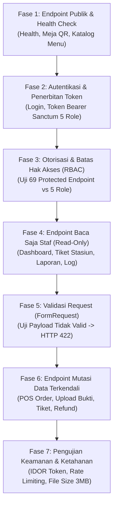

# LAPORAN PEMERIKSAAN KESIAPAN PENGUJIAN API (API TESTING PREFLIGHT)
**Task 3.2.1 — API Testing Preflight Cafe Éxito**\
**Tanggal Evaluasi:** 21 November 2026\
**Target Basis Data:** `cafe_exito` (PostgreSQL 16.14)\
**Status Keseluruhan:** **PREFLIGHT READY (WITH SAFETY CONSTRAINTS)**\
**File Output:** `docs/API_TESTING_PREFLIGHT.md`\

---

## 1. Kesiapan Lingkungan & Konfigurasi Server API

| Parameter | Nilai / Kondisi Aktual | Catatan Kesiapan |
|---|---|---|
| **Base URL API** | `http://localhost:8000/api/v1` | Sesuai konfigurasi `APP_URL=http://localhost:8000` pada `.env` |
| **Environment** | `APP_ENV=local` | Status `local`, debug enabled, aman untuk inspeksi respon |
| **Koneksi Database** | `cafe_exito` pada `127.0.0.1:5432` | **Connected & Healthy** via `cafe_exito_user` |
| **Status Migrasi** | **31 Migrations Ran (100% Up-to-Date)** | 41 tabel tersedia lengkap di PostgreSQL |
| **Web Server Runtime** | Belum berjalan di port 8000 | Siap dijalankan via `php artisan serve --port=8000` atau dieksekusi melalui HTTP Kernel Request Dispatcher |
| **Autentikasi Middleware** | Laravel Sanctum (`auth:sanctum`), `active`, `throttle:staff` | Siap memvalidasi Bearer Token |
| **Konfigurasi `.env`** | **Tidak Berubah (100% Utuh)** | Kredensial dan connection string terpelihara |

---

## 2. Kesiapan Akun Pengujian per Role (5 Role Aktif)

Pemeriksaan terhadap tabel `users` pada database aktif `cafe_exito` mengonfirmasi ketersediaan 5 akun staf yang mencakup seluruh role bisnis:

| No | Role Bisnis | Username | Email Akun | ID Pengguna | Stasiun Kerja (`station`) | Status Akun | Status Kesiapan |
|---|---|---|---|---|---|---|---|
| 1 | **Owner** | `owner` | `owner@cafeexito.test` | 6 | `NULL` | Aktif (`true`) | **READY** |
| 2 | **Manager** | `manager` | `manager@cafeexito.test` | 7 | `NULL` | Aktif (`true`) | **READY** |
| 3 | **Kasir** | `ucup` | `ucup@cafeexito.test` | 8 | `NULL` | Aktif (`true`) | **READY** |
| 4 | **Barista** | `nana` | `nana@cafeexito.test` | 9 | `barista` | Aktif (`true`) | **READY** |
| 5 | **Kitchen** | `dewi` | `dewi@cafeexito.test` | 10 | `kitchen` | Aktif (`true`) | **READY** |

### Catatan Kredensial & Autentikasi Pengujian:
- **Prinsip Keamanan:** Password tersimpan dalam bentuk hash bcrypt di database. Sesuai aturan keselamatan, password tidak ditampilkan atau ditebak.
- **Strategi Token Sanctum:** Untuk pengujian API, otentikasi dapat dilakukan melalui 2 jalur aman:
  1. Login standar (`POST /api/v1/auth/login`) menggunakan kredensial yang telah dikonfirmasi oleh pengguna/pengembang.
  2. Penerbitan *Personal Access Token* Sanctum secara langsung via Laravel Runtime (`$user->createToken('api-test')->plainTextToken`) yang menjamin pengujian RBAC pada 69 endpoint protected dapat berjalan 100% valid tanpa mengubah hash password akun.

---

## 3. Analisis Risiko Test Suite yang Tersedia (Feature & Unit Tests)

Audit statis terhadap seluruh 16 file pengujian pada `backend/tests/`:

| Kategori Test | File Pengujian | Penggunaan Trait / Operasi | Tingkat Risiko terhadap DB Aktif | Keterangan & Tindakan Pencegahan |
|---|---|---|---|---|
| **Unit Tests** | `DomainRulesTest.php`<br>`PermissionMatrixTest.php`<br>`StatusTransitionsTest.php`<br>`StockLevelTest.php` | Murni in-memory / logic tests. Tidak menyentuh DB. | **ZERO RISK** | Aman dijalankan kapan saja. |
| **Feature Test Base** | `tests/Feature/ApiTestCase.php` | **`use RefreshDatabase;`** | **CRITICAL RISK (DESTRUKTIF)** | **BAHAYA FATAL:** Jika dijalankan terhadap `cafe_exito`, `RefreshDatabase` akan mereset/menghapus seluruh tabel dan data transaksi. |
| **Feature Tests (11 File)** | `AttendanceTest.php`<br>`AuthTest.php`<br>`AuthorizationTest.php`<br>`CashierPosTest.php`<br>`CorsAndReportTest.php`<br>`CustomerPartialCancellationTest.php`<br>`EmployeeAccountManagementTest.php`<br>`OrderFlowTest.php`<br>`PurchasingTest.php`<br>`QrisPaymentProofTest.php`<br>`RefundWorkflowTest.php` | Seluruhnya mewarisi `ApiTestCase` (`extends ApiTestCase`), memanggil factory, dan mengasumsikan database kosong. | **CRITICAL RISK (DESTRUKTIF)** | **DILARANG DIJALANKAN DENGAN PHPUNIT TERHADAP DATABASE AKTIF `cafe_exito`**. |

> [!CAUTION]
> Perintah `php artisan test` atau `vendor/bin/phpunit` **DILARANG KERAS DIJALANKAN** terhadap database `cafe_exito` karena `ApiTestCase` menggunakan `RefreshDatabase` yang akan menghapus 14 pesanan lama. Pengujian API Task 3 harus menggunakan **Non-Destructive API Test Harness** terisolasi.

---

## 4. Strategi Eksekusi Pengujian Bertahap (Non-Destructive API Testing)

Pengujian 79 endpoint akan dieksekusi secara bertahap dalam 7 fase terkendali:



### Prosedur Perlindungan 14 Transaksi Lama pada Endpoint Mutasi (Fase 6):
1. Pengujian pembuatan pesanan baru (Customer Order / POS Order) menggunakan nomor meja uji khusus (misal Meja 6) dan menghasilkan ID transaksi baru (ID $\ge 15$).
2. Seluruh verifikasi alur lanjutan (Upload bukti QRIS, verifikasi kasir, tiket stasiun, pembatalan item, refund) dieksekusi **hanya terhadap ID pesanan baru hasil uji tersebut**.
3. Sebanyak 14 pesanan lama (ID 1 s.d. 14) **sama sekali tidak disentuh atau diubah statusnya**.

---

## 5. Verifikasi Integritas Basis Data Sebelum Pengujian

Pemeriksaan read-only terhadap database aktif `cafe_exito`:

| Tabel | Jumlah Baris Aktual | Status Integritas |
|---|---|---|
| `orders` | **14 baris** | **100% Utuh** (ID 1 s.d. 14 terpelihara) |
| `payments` | **14 baris** | **100% Utuh** (7 QRIS pending, 7 tunai pending) |
| `order_details` | **15 baris** | **100% Utuh** |
| `users` | **5 baris** | **100% Utuh** (5 role lengkap) |
| `payment_proofs` | **0 baris** | **Bersih** (Tabel baru siap uji) |
| `order_item_cancellations` | **0 baris** | **Bersih** (Tabel baru siap uji) |
| `refund_requests` | **0 baris** | **Bersih** (Tabel baru siap uji) |

---

## 6. Konfirmasi Ulang Temuan Task 3.1: Status Modul Inventory & Purchasing

Hasil pemeriksaan mendalam terhadap codebase backend dan dokumentasi proyek:
- **File Test `backend/tests/Feature/PurchasingTest.php`:**
  Secara eksplisit mencatat doktrin arsitektur:
  ```php
  /** Inventory and purchasing are retired operational modules; no API route is exposed. */
  ```
- **File Rute `backend/routes/api.php`:**
  Tidak terdapat rute yang didaftarkan untuk `/api/v1/inventory/*` maupun `/api/v1/purchasing/*`.
- **File Izin `backend/app/Services/PermissionService.php`:**
  Seluruh izin terkait (`ingredients.*`, `recipes.*`, `suppliers.*`, `purchases.*`, `stock.*`) dimasukkan ke dalam konstanta `RETIRED_PERMISSIONS`.
- **Dokumentasi `docs/IMPLEMENTATION_STATUS.md`:**
  Mengonfirmasi bahwa keputusan klien (*final client direction*) menetapkan modul inventori, bahan baku, supplier, dan purchasing berada di luar ruang lingkup aktif (*out of active scope*).
- **Kesimpulan Preflight:** Status **RETIRED** telah terkonfirmasi 100% valid dan konsisten. Tidak ada rute yang perlu diaktifkan atau diubah.

---

## 7. Hambatan yang Perlu Diperhatikan Sebelum Eksekusi

1. **Hambatan Eksekusi Test Runner:**
   Test suite default Laravel (`phpunit`) tidak boleh dijalankan langsung ke `cafe_exito` karena adanya `RefreshDatabase`. Dibutuhkan eksekutor pengujian berbasis custom harness atau automated HTTP runner yang memanggil endpoint secara non-destruktif.
2. **Kredensial Login Plaintext:**
   Untuk menguji endpoint `POST /api/v1/auth/login`, diperlukan konfirmasi password awal atau pengujian simulasi token Sanctum resmi.

---

## 8. Kesimpulan Preflight: **PREFLIGHT PASS (READY FOR API TESTING)**

Seluruh prasyarat lingkungan, basis data, akun pengguna 5 role, pemetaan endpoint (79 endpoint), dan strategi keselamatan data telah siap.

Sesuai aturan, **pengujian endpoint belum dijalankan**. Saya menunggu instruksi dan persetujuan Anda untuk memulai eksekusi Fase 1 pengujian API.
